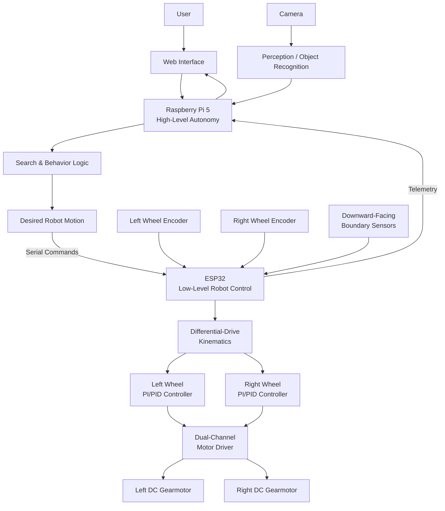
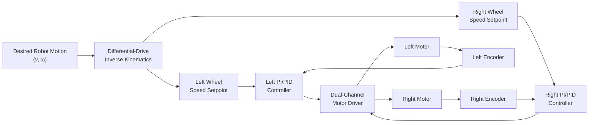
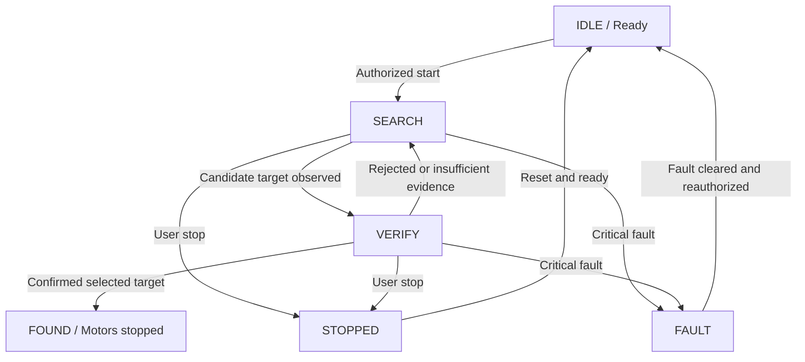

# SEEKR System Architecture

## Overview

SEEKR uses a two-controller architecture.

The **Raspberry Pi 5** acts as the high-level computer. It handles the web interface, target selection, camera processing, object recognition, search logic, and overall robot behavior.

The **ESP32** handles the time-sensitive hardware layer. It controls the motors, reads the wheel encoders and boundary sensors, performs differential-drive motion control, and communicates with the Raspberry Pi.

This separation keeps compute-intensive vision and decision-making on Linux while allowing the ESP32 to handle real-time motor and sensor tasks.

SEEKR Version 1 is planned as a **differential-drive robot with two independently driven wheels and one passive caster wheel**.

## Mechanical Platform

SEEKR Version 1 will use a differential-drive layout consisting of:

- two independently driven wheels
- two geared DC motors with encoders
- one passive caster wheel
- a custom chassis designed for the electronics, battery, camera, and sensors

The left and right motors provide both translation and steering.

Equal wheel speeds produce approximately straight-line motion. Different wheel speeds produce curved motion, while equal and opposite wheel speeds allow the robot to rotate approximately in place.

The chassis will be designed using CAD and manufactured using available 3D-printing and/or laser-cutting resources.

## Raspberry Pi Responsibilities

The Raspberry Pi 5 is responsible for high-level robot behavior.

Its responsibilities include:

- running the Linux-based application environment
- hosting the SEEKR web interface
- receiving the user's selected target object
- acquiring camera data
- running the object-recognition and perception pipeline
- running the search strategy
- maintaining the robot's high-level state machine
- deciding the desired robot movement
- sending motion commands to the ESP32
- receiving ESP32 telemetry
- logging robot status and experimental data
- reporting mission status to the web interface

The Raspberry Pi should not directly control motor PWM or perform timing-sensitive encoder acquisition.

## ESP32 Responsibilities

The ESP32 is responsible for low-level robot control and hardware interaction.

Its responsibilities include:

- receiving desired motion commands from the Raspberry Pi
- converting desired robot motion into left and right wheel-speed setpoints
- performing differential-drive inverse kinematics where required
- running independent left and right wheel PI/PID control loops
- generating PWM and direction signals for the motor driver
- reading left and right wheel encoders
- measuring wheel speed
- reading downward-facing boundary sensors
- executing immediate low-level safety behavior
- collecting hardware telemetry
- sending telemetry and status information to the Raspberry Pi

The ESP32 should continue handling critical low-level behavior even if the Raspberry Pi is temporarily delayed by vision or high-level computation.

## Motor and Control Subsystem

SEEKR uses two independently controlled geared DC motors.

The control chain is:

The wheel encoders provide feedback so the ESP32 can compare requested wheel speeds with measured wheel speeds.

This allows SEEKR to compensate for differences caused by:

- motor variation
- friction
- mechanical load
- battery voltage
- wheel-floor interaction

PI control may be sufficient for Version 1. PID behavior will be evaluated experimentally once the actual motors and chassis are available.

## Wheel Encoders

Each drive motor will have an encoder.

Encoder measurements allow the ESP32 to estimate:

- wheel rotational speed
- wheel travel distance
- left/right wheel-speed differences
- approximate robot movement

Encoder feedback is primarily required for closed-loop wheel-speed control.

Wheel odometry may also be computed and transmitted to the Raspberry Pi if the search or navigation system benefits from an approximate robot pose.

Full localization is not a requirement for SEEKR Version 1.

## Wheel Odometry

Encoder measurements can be used to estimate SEEKR's relative pose:

$$
(x,\ y,\ \theta)
$$

where:

- $x$ represents estimated horizontal position
- $y$ represents estimated vertical position
- $\theta$ represents estimated heading

Odometry is expected to accumulate error because of wheel slip, measurement inaccuracies, and imperfect mechanical dimensions.

For this reason, odometry should be treated as an estimate rather than absolute ground truth.

Whether continuous pose tracking is required by the Version 1 search system will be decided during integration.

## IMU

An IMU is not currently required for Version 1.

If added, an IMU could provide an independent measurement of chassis rotation and improve heading estimation.

Possible future uses include:

- comparing gyro heading changes with encoder-derived heading changes
- detecting possible wheel slip
- improving orientation estimation
- supporting future localization systems

The mechanical and software architecture should leave room for an IMU without making it a dependency for the initial robot.

## Camera and Perception Subsystem

The camera supplies frames to the Raspberry Pi 5. Eli's perception subsystem evaluates them for the user's chosen target among four known objects. The output is an observation, **not** a motor command.

Candidate observation fields include target identity, confidence, bounding box or center, frame capture time, optional frame ID, and explicit DETECTED, NO_DETECTION, and ERROR states. The Pi must distinguish fresh observations from stale or frozen ones; healthy serial communication does not guarantee healthy perception.

For V1, a trustworthy target candidate moves the mission from SEARCH to VERIFY. The team will define verification evidence and timeout rules before implementation. Confirmed visual detection satisfies the current V1 FOUND condition. Camera alignment and practical mounting checks are required during integration; target approach is not required for V1.

Eli owns perception and high-level search software. Toufic owns the embedded motion/safety platform; both collaborate on the interface and integration.
## Search and Behavior Logic

The Raspberry Pi owns the mission state machine; the ESP32 owns independent local motor safety.

**V1 mission:** select one of four objects → autonomously search inside the taped arena → visually verify the selected object → stop and report FOUND. No approach-to-target or retrieval is required.

ALIGN and APPROACH remain future enhancements, not active V1 states. The search algorithm and the exact confirmation rule will be agreed with Eli before implementation. A boundary event may cause a local ESP32 stop and a Pi-coordinated recovery; recovery must never bypass low-level safety.

STOPPED represents a normal interruption. FAULT represents an abnormal condition requiring explicit clearance and reauthorization. No restart or reconnection automatically restores old motion.
## Boundary Detection

Downward-facing IR reflectance sensors will monitor the black-tape perimeter of a flat wooden-floor arena. The ESP32 enforces a local boundary inhibit and safe stop independently of Raspberry Pi processing.

**Detection does not guarantee containment.** Sensor coverage, tape width, chassis swept footprint, detection latency, speed, and stopping distance must be assessed and tested with the physical robot. Sensor count and placement are not finalized; corner-region coverage is only an initial design candidate.

After an event, the Pi may request a cautious recovery maneuver, but the ESP32 must allow only motion consistent with its safety restrictions. Reversing is not inherently safe. Uncertain clearance, invalid sensor data, or loss of valid control commands keeps the robot stopped. Boundary events and faults are reported in telemetry.
## Raspberry Pi ↔ ESP32 Communication

The controllers exchange commands and telemetry over **serial communication**, using USB serial or direct UART depending on final hardware selection.

- **Pi → ESP32:** authorized robot linear/angular velocity or wheel-speed requests, STOP, startup/session synchronization, and selected configuration.
- **ESP32 → Pi:** readiness, wheel speeds, encoder data, boundary states/events, controller faults, motion-inhibit status, acknowledgements for selected messages, and optional odometry.

The ESP32 must validate framing, fields, limits, and command/session freshness before executing movement. Missing fresh authorized commands trigger a safe stop; heartbeat or reconnection alone does not authorize motion. A reset requires synchronization before new motion. Low-level wheel-speed loops remain on the ESP32.

The candidate message formats, acknowledgement/sequence/CRC rules, timing, and fault semantics will be finalized through `docs/protocol.md` and physical testing.
## Web Interface

The web interface provides the user-facing control layer.

For Version 1, the user should be able to:

- select one of four target objects
- start a search mission
- view the current robot state
- determine whether the target was found
- stop the robot if required

The web interface is expected to run on or be served by the Raspberry Pi.

The exact UI framework and network configuration are not yet finalized.

## System Data Flow

1. Both controllers power on in a motor-safe condition and establish readiness.
2. A user selects one of the four target objects and starts an authorized mission.
3. The Pi enters SEARCH, processes fresh camera observations, and chooses a search movement.
4. The Pi transmits validated, time-bounded motion requests to the ESP32.
5. The ESP32 enforces safety, computes wheel-speed targets, and regulates both motors using encoder feedback.
6. The ESP32 monitors tape sensors and reports motor, boundary, and fault telemetry.
7. A possible selected-object detection leads the Pi to VERIFY; rejected candidates return to SEARCH.
8. Upon confirmed visual identification, the Pi requests STOP and enters FOUND only when the robot is safely stopped according to the final state/telemetry contract.
9. The web interface reports the selected object and mission result.
10. Stop requests, boundary events, stale perception, serial loss, and faults take precedence over ordinary mission movement as defined by their owning safety mechanisms.
## Version 1 Scope

**Included in V1**
- Flat indoor wooden-floor arena with black-tape perimeter and no intentional obstacles.
- Four known target objects, with their positions varied between trials.
- User target selection, mission start/stop, and status reporting through a web interface.
- Autonomous search, selected-target visual detection, and confirmation (VERIFY).
- Safe stopping and FOUND reporting once the confirmation condition is met.
- Two powered wheels with encoders plus one passive caster.
- ESP32 closed-loop wheel-speed control, boundary sensing/inhibit, and independent command freshness timeout.
- Raspberry Pi perception/search/mission logic and bidirectional serial telemetry.
- Progressive hardware and full-system testing.

**Not required for V1**
- Aligning to or approaching the target after verification.
- Object pickup, gripper, robotic arm, or retrieval.
- Obstacle avoidance, LiDAR, SLAM, room mapping, or tape-free navigation.
- IMU-based sensor fusion, full localization, arbitrary-object recognition, or ROS 2.

Future versions can add ALIGN/APPROACH, retrieval, and unconstrained navigation without changing the V1 acceptance criteria.
## Design Status

This document defines the **current V1 planning baseline**, not completed hardware or software. The current success condition is visually verified target detection followed by a safe stop and FOUND report. Any decision to add APPROACH to V1 must be agreed with Eli and updated in the requirements, architecture, README, and tests together.

Open implementation decisions include motor/wheel/driver selection, chassis dimensions, battery and protected voltage rails, sensor and camera choice, PI/PID tuning, search strategy, verification criterion, the exact Pi–ESP32 protocol, and measurable acceptance thresholds. Wheel odometry may be used where useful; full localization and an IMU are optional.

See `docs/requirements.md` for scope, `docs/protocol.md` for communication, `docs/hardware.md` for component decisions, `docs/integration.md` for cross-subsystem handoffs, and `docs/testing.md` for verification.
