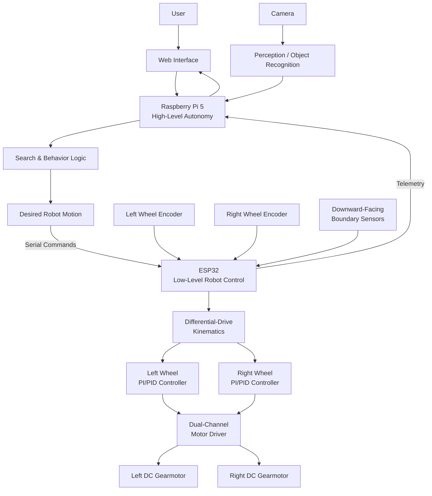
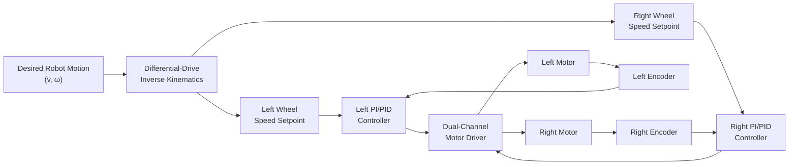
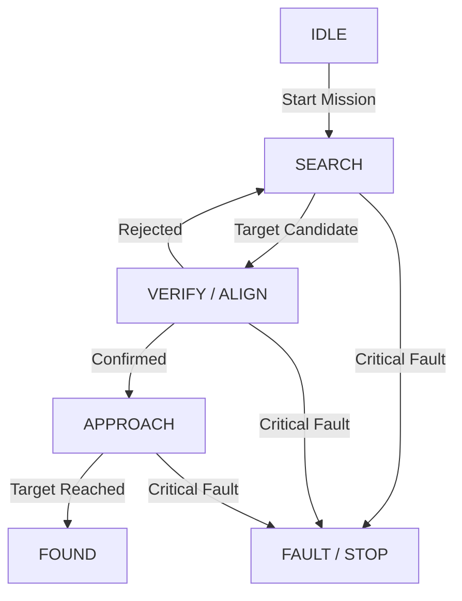

# SEEKR System Architecture

## Overview

SEEKR uses a two-controller architecture.

The **Raspberry Pi 5** acts as the high-level computer. It handles the web interface, target selection, camera processing, object recognition, search logic, and overall robot behavior.

The **ESP32** handles the time-sensitive hardware layer. It controls the motors, reads the wheel encoders and boundary sensors, performs differential-drive motion control, and communicates with the Raspberry Pi.

This separation keeps compute-intensive vision and decision-making on Linux while allowing the ESP32 to handle real-time motor and sensor tasks.

SEEKR Version 1 is planned as a **differential-drive robot with two independently driven wheels and one passive caster wheel**.

## Mechanical Platform

SEEKR Version 1 will use a differential-drive layout consisting of:

- two independently driven wheels
- two geared DC motors with encoders
- one passive caster wheel
- a custom chassis designed for the electronics, battery, camera, and sensors

The left and right motors provide both translation and steering.

Equal wheel speeds produce approximately straight-line motion. Different wheel speeds produce curved motion, while equal and opposite wheel speeds allow the robot to rotate approximately in place.

The chassis will be designed using CAD and manufactured using available 3D-printing and/or laser-cutting resources.

## Raspberry Pi Responsibilities

The Raspberry Pi 5 is responsible for high-level robot behavior.

Its responsibilities include:

- running the Linux-based application environment
- hosting the SEEKR web interface
- receiving the user's selected target object
- acquiring camera data
- running the object-recognition and perception pipeline
- running the search strategy
- maintaining the robot's high-level state machine
- deciding the desired robot movement
- sending motion commands to the ESP32
- receiving ESP32 telemetry
- logging robot status and experimental data
- reporting mission status to the web interface

The Raspberry Pi should not directly control motor PWM or perform timing-sensitive encoder acquisition.

## ESP32 Responsibilities

The ESP32 is responsible for low-level robot control and hardware interaction.

Its responsibilities include:

- receiving desired motion commands from the Raspberry Pi
- converting desired robot motion into left and right wheel-speed setpoints
- performing differential-drive inverse kinematics where required
- running independent left and right wheel PI/PID control loops
- generating PWM and direction signals for the motor driver
- reading left and right wheel encoders
- measuring wheel speed
- reading downward-facing boundary sensors
- executing immediate low-level safety behavior
- collecting hardware telemetry
- sending telemetry and status information to the Raspberry Pi

The ESP32 should continue handling critical low-level behavior even if the Raspberry Pi is temporarily delayed by vision or high-level computation.

## Motor and Control Subsystem

SEEKR uses two independently controlled geared DC motors.

The control chain is:

The wheel encoders provide feedback so the ESP32 can compare requested wheel speeds with measured wheel speeds.

This allows SEEKR to compensate for differences caused by:

- motor variation
- friction
- mechanical load
- battery voltage
- wheel-floor interaction

PI control may be sufficient for Version 1. PID behavior will be evaluated experimentally once the actual motors and chassis are available.

## Wheel Encoders

Each drive motor will have an encoder.

Encoder measurements allow the ESP32 to estimate:

- wheel rotational speed
- wheel travel distance
- left/right wheel-speed differences
- approximate robot movement

Encoder feedback is primarily required for closed-loop wheel-speed control.

Wheel odometry may also be computed and transmitted to the Raspberry Pi if the search or navigation system benefits from an approximate robot pose.

Full localization is not a requirement for SEEKR Version 1.

## Wheel Odometry

Encoder measurements can be used to estimate SEEKR's relative pose:

$$
(x,\ y,\ \theta)
$$

where:

- $x$ represents estimated horizontal position
- $y$ represents estimated vertical position
- $\theta$ represents estimated heading

Odometry is expected to accumulate error because of wheel slip, measurement inaccuracies, and imperfect mechanical dimensions.

For this reason, odometry should be treated as an estimate rather than absolute ground truth.

Whether continuous pose tracking is required by the Version 1 search system will be decided during integration.

## IMU

An IMU is not currently required for Version 1.

If added, an IMU could provide an independent measurement of chassis rotation and improve heading estimation.

Possible future uses include:

- comparing gyro heading changes with encoder-derived heading changes
- detecting possible wheel slip
- improving orientation estimation
- supporting future localization systems

The mechanical and software architecture should leave room for an IMU without making it a dependency for the initial robot.

## Camera and Perception Subsystem

The camera provides visual observations to the Raspberry Pi.

The perception subsystem evaluates camera frames for the object currently selected by the user.

SEEKR Version 1 will search for one of four known target objects.

A successful perception output may contain information such as:

- object class
- detection confidence
- bounding-box position
- target center position in the image
- approximate target size in the image

The high-level behavior system can use this information to determine whether the robot should continue searching, rotate toward the object, approach it, or report success.

The exact model, neural-network architecture, training process, and detection thresholds remain implementation decisions.

## Search and Behavior Logic

The Raspberry Pi maintains SEEKR's high-level robot state.

The initial behavior model is expected to contain states similar to:

The exact search strategy is not defined by this architecture document.

The search subsystem determines **where the robot should move**, while the ESP32 motion-control subsystem determines **how the physical robot executes that movement**.

## Boundary Detection

SEEKR Version 1 operates inside a flat arena surrounded by a black tape boundary.

Downward-facing reflectance sensors will detect the boundary.

Boundary detection is treated as a low-level safety function.

If a boundary is detected, the ESP32 should be capable of immediately stopping or preventing further outward movement without waiting for a Raspberry Pi decision.

The ESP32 will then report the event to the Raspberry Pi.

The Raspberry Pi can decide the appropriate recovery behavior, such as:

- reversing
- turning
- resuming the search
- entering a fault state

The tape boundary is a Version 1 containment mechanism. It is not a substitute for mapping, localization, or obstacle avoidance.

## Raspberry Pi ↔ ESP32 Communication

The Raspberry Pi and ESP32 will communicate using a serial interface.

The physical implementation may use USB serial or direct UART depending on the final hardware configuration.

The Raspberry Pi sends high-level commands such as desired motion or robot-state commands.

The ESP32 returns telemetry such as:

- left wheel speed
- right wheel speed
- encoder counts
- boundary-sensor state
- controller state
- motor state
- fault information
- optional odometry information

The final packet format, update frequency, acknowledgement system, and error handling will be defined in `protocol.md`.

## Web Interface

The web interface provides the user-facing control layer.

For Version 1, the user should be able to:

- select one of four target objects
- start a search mission
- view the current robot state
- determine whether the target was found
- stop the robot if required

The web interface is expected to run on or be served by the Raspberry Pi.

The exact UI framework and network configuration are not yet finalized.

## System Data Flow

1. The user selects one of four target objects using the web interface.
2. The Raspberry Pi records the requested target.
3. SEEKR enters the search state.
4. The camera continuously provides frames to the perception system.
5. The perception system reports whether the requested target is visible.
6. The high-level search and behavior logic decides the desired robot motion.
7. The Raspberry Pi sends the motion request to the ESP32.
8. The ESP32 converts the requested motion into left and right wheel-speed setpoints.
9. Independent PI/PID controllers regulate the two wheel speeds using encoder feedback.
10. The ESP32 drives the motors through the motor driver.
11. Boundary sensors are continuously monitored.
12. If the tape boundary is detected, the ESP32 executes an immediate protective response and reports the event.
13. The ESP32 continuously sends telemetry to the Raspberry Pi.
14. When the requested object is detected, SEEKR transitions from search to verification/alignment.
15. Once aligned, SEEKR approaches the object.
16. When the near-target condition is satisfied, SEEKR stops and enters the FOUND state.
17. The web interface reports mission success to the user.

## Version 1 Scope

SEEKR Version 1 is intentionally constrained.

Version 1 includes:

- flat indoor floor
- bounded arena
- black tape perimeter
- no intentional obstacles
- four known target objects
- randomized object positions
- autonomous target search
- autonomous target recognition
- target alignment and approach
- two-wheel differential-drive motion
- encoder-based closed-loop motor control
- Raspberry Pi and ESP32 communication
- web-based target selection and robot status

Version 1 does **not** require:

- object pickup or retrieval
- robotic arm or gripper
- obstacle avoidance
- SLAM
- LiDAR
- autonomous room mapping
- multi-room navigation
- removal of the tape boundary
- full-house localization
- generalized recognition of arbitrary objects

These capabilities may be considered in later SEEKR versions.

## Design Status

This document represents the current planned SEEKR Version 1 architecture.

Several implementation decisions remain intentionally open until hardware is selected and tested, including:

- exact motor model
- motor-driver model
- wheel dimensions
- PI versus PID control
- control-loop frequency
- battery and power architecture
- boundary-sensor selection
- camera selection
- exact Raspberry Pi ↔ ESP32 serial protocol
- perception model
- search strategy
- odometry requirements
- optional IMU use

The architecture may evolve during prototyping, but the separation between high-level Raspberry Pi behavior and low-level ESP32 hardware control is expected to remain a core design principle.