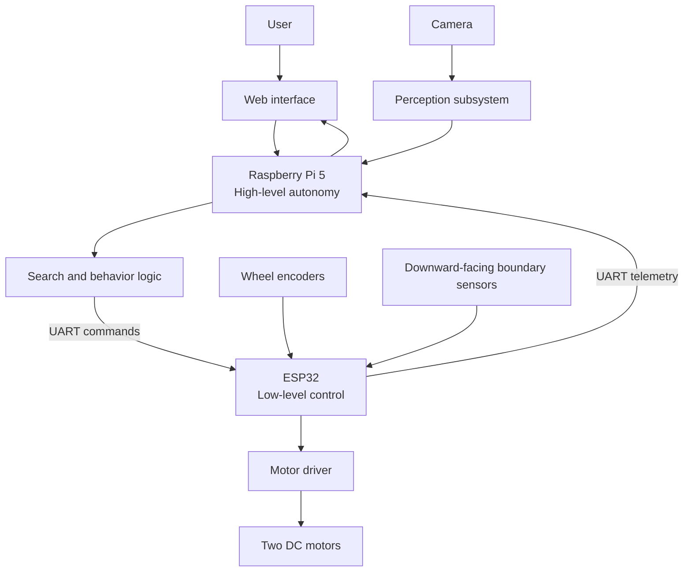

# SEEKR System Architecture

## Overview

SEEKR uses a two-controller architecture. The Raspberry Pi 5 acts as the high-level brain: it hosts the web interface, target selection, perception pipeline, search logic, and overall robot state. The ESP32 handles responsive hardware-facing work: motor actuation, encoder acquisition, boundary sensing, and communication with the Raspberry Pi.

This separation keeps compute-intensive vision and decision-making on Linux while isolating timing-sensitive hardware control on the microcontroller.

## Raspberry Pi Responsibilities

- Run the Linux-based application environment.
- Host the web interface for target selection and status reporting.
- Acquire or coordinate camera input for perception.
- Run target-recognition and high-level perception logic.
- Maintain the search, approach, success, and fault-handling states.
- Convert high-level behavior decisions into motion commands for the ESP32.
- Receive, log, and interpret ESP32 telemetry.

## ESP32 Responsibilities

- Generate low-level control outputs for the motor driver.
- Read wheel encoders for motion feedback.
- Read downward-facing sensors used to identify the tape boundary.
- Apply defined stop or boundary-response behavior when required.
- Parse Raspberry Pi commands and send telemetry over UART.
- Provide hardware-state information for diagnostics and integration.

## Camera and Perception Subsystem

The camera provides visual observations to the Raspberry Pi. The perception subsystem will evaluate frames for the currently selected target among the four known objects. Its output should communicate detection confidence and, where available, target position or directional information needed by the approach behavior. Recognition approach, model selection, calibration, and operating thresholds remain design decisions to be validated during development.

## Motor and Control Subsystem

The rover is planned as a two-motor differential-drive platform. The Raspberry Pi requests high-level movement; the ESP32 translates those requests into motor-driver outputs and uses wheel encoders as feedback. Control-loop design, velocity units, command limits, and odometry use are not finalized and will be documented as they are implemented.

## Boundary Detection

Downward-facing sensors will detect the black tape perimeter of the arena. The ESP32 will report boundary readings to the Raspberry Pi and may execute a low-level protective stop or response, depending on the final safety design. Boundary sensing is a containment mechanism for Version 1; it is not a substitute for mapping or obstacle avoidance.

## Web Interface

The web interface will allow a user to select one of four target objects and observe robot status. It is expected to run on or be served by the Raspberry Pi. The final UI technology, network configuration, and detailed status model are not yet selected.

## System Data Flow

1. The user chooses a target in the web interface.
2. The Raspberry Pi records the selected target and enters a search state.
3. Camera data is processed to evaluate whether the selected target is visible.
4. The search logic selects a behavior and sends movement commands over UART.
5. The ESP32 controls the motors and collects encoder and boundary data.
6. The ESP32 returns telemetry to the Raspberry Pi.
7. On target detection, the Raspberry Pi changes to an approach behavior, then a stopped/success state when its near-target condition is met.
8. The web interface presents the resulting status.

## Design Status

This is an initial architecture for planning and early prototyping. Component interfaces, safety behavior, protocol details, perception approach, and control algorithms are subject to change as hardware is selected and tested.
