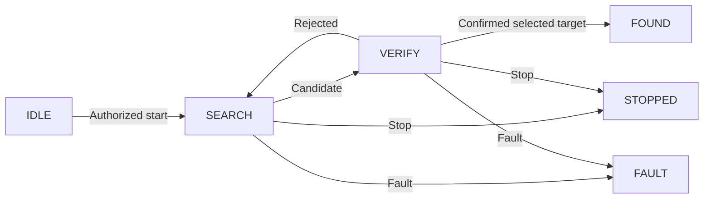

# SEEKR V1 Integration Plan

**Status:** Coordination and build-readiness document. Interfaces described here are conceptual until both teammates approve them.

## Responsibility Boundary

| Subsystem | Primary owner | Contract/hand-off |
| --- | --- | --- |
| Hardware, chassis, power | Toufic | Electrical/mechanical limits and readiness |
| ESP32 control, encoders, boundary safety | Toufic | Accept authorized motion; return state/telemetry |
| Serial transport integration | Toufic, coordinated with Eli | Agreed messages, units, error handling |
| Perception and camera processing | Eli | Fresh structured observations of selected target |
| Search and high-level behavior | Eli | Safe requested robot motion and mission states |
| End-to-end acceptance and test logging | Shared | Traceable trials, failures and successful FOUND |

## Key Interface Contracts (To Be Finalized)

**Perception → behavior (Pi-local):** selected object identity/class, DETECTED/NO_DETECTION/ERROR, confidence, bounding box/center, capture timestamp, optional frame ID; behavior rejects stale observations.

**Behavior → ESP32 (serial):** desired robot motion or wheel-speed request, STOP and valid session/authorization context. Motor PWM is never a Pi-level command. Define units, axes/signs, bounds and freshness.

**ESP32 → behavior (serial):** readiness, measured wheel speeds, encoder information, boundary inhibit/events, faults, and optional odometry. An ACK confirms the defined message-acceptance stage, not necessarily physical completion.

**Web → mission (Pi):** selected target, authorized START/STOP, robot status and FOUND/STOPPED/FAULT outcome.

## Core V1 State Flow

FOUND requires confirmed visual detection **and safe motor stopping**. ALIGN and APPROACH are deferred.

## Failure Ownership

- **Boundary:** ESP32 independently stops/inhibits unsafe movement, then reports event; Pi may plan only safely permitted recovery.
- **Stale commands / broken serial:** ESP32 stops on loss of fresh valid authorization, regardless of Pi mission state.
- **Frozen frames / stale observations:** Pi inhibits perception-dependent motion; healthy UART does not mean healthy camera.
- **ESP32 reset / Pi restart:** require safe outputs, fresh session synchronization, and reauthorization; no automatic resumption.
- **Encoder/motor faults:** ESP32 detects actionable tracking issues when feasible and reports/inhibits as appropriate.
- **User STOP:** clear motion authorization; report STOPPED (unless a critical fault requires FAULT).

## Integration Sequence

1. Bench safety and power checks.
2. Single motor + encoder validation.
3. Dual-motor closed-loop motion.
4. Differential-drive chassis and geometry calibration.
5. Tape sensor calibration and measured containment.
6. Pi–ESP32 serial link, session, timeout, STOP and fault injection.
7. Pi simulated motion command + telemetry test.
8. Eli's perception verification with recorded/simulated inputs.
9. Full state-machine integration using simulated detections.
10. Supervised, repeatable autonomous search trials and V1 acceptance review.

## Open Team Decisions

- Exact definition of target verification (number/consistency of observations, confidence and age thresholds).
- Search behavior and mission timeout.
- Movement API/units/signs and fault codes.
- Containment limit and measured stopping-margin requirements.
- Chassis and component selections and power budget.
- Quantitative V1 acceptance thresholds after initial tests.

Record agreed decisions in their owning documents: scope in requirements, layout in architecture/hardware, message rules in protocol, and measured evidence in testing.
