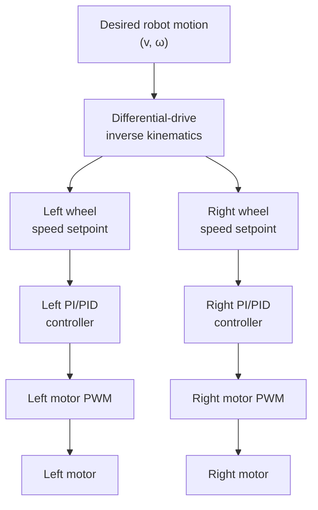
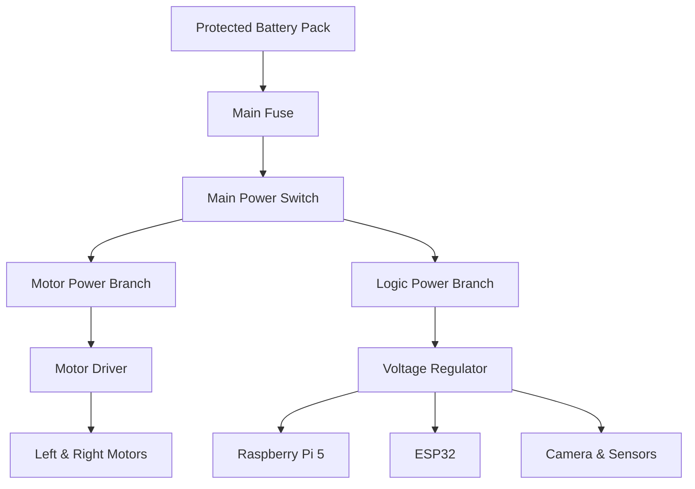
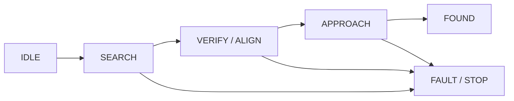

# Robotics & Embedded Systems Learning Notes

These notes document the concepts I learn while building the autonomous mapping robot.

## 1. DC Motors

### What is it?
A brushed DC motor converts electrical energy into rotational mechanical energy. Current flowing through coils in a magnetic field produces torque that rotates the shaft. Voltage influences speed, while current is related to torque.

### Why does our robot need it?
SEEKR uses two independently driven wheels for differential-drive movement. Geared DC motors reduce output RPM and increase available wheel torque, allowing controlled movement and sufficient driving force.

## 2. Motor Drivers & H-Bridges

### What is it?
A motor driver is an electronic circuit that uses low-power control signals to switch electrical power from a separate supply to a motor. An H-bridge is a four-switch arrangement that reverses the polarity across a DC motor to control its direction.

### Why does our robot need it?
The ESP32 GPIO pins cannot directly supply the voltage and current required by our geared DC motors. SEEKR needs two independently controlled H-bridge channels to drive its left and right wheels, allowing forward motion, reverse motion, and differential steering.

## 3. PWM Speed Control

### What is it?
Pulse Width Modulation (PWM) controls the average electrical drive by rapidly switching a signal between HIGH and LOW. Duty cycle is the percentage of each period spent HIGH, while frequency is the number of PWM cycles per second.

### Why does our robot need it?
SEEKR uses PWM from the ESP32 to command the motor driver and control the speed of each geared DC motor. Different PWM duty cycles allow the left and right wheels to run at different speeds for differential-drive movement and steering.

## 4. Wheel Encoders

### What is it?
A rotary encoder is a sensor that generates electrical signals as a motor shaft rotates. By counting these signals, the ESP32 can measure rotational displacement and calculate rotational speed. A quadrature encoder uses channels A and B, offset by 90 electrical degrees, so the direction of rotation can also be determined.

Important relationships:

- Wheel counts per revolution depend on the encoder resolution and the gearbox ratio.
- Wheel revolutions = encoder counts / counts per wheel revolution.
- Distance travelled = wheel revolutions × wheel circumference.
- Wheel RPM can be calculated from the number of wheel revolutions measured over a known time interval.

### Why does our robot need it?
SEEKR needs an encoder on each drive motor so the left and right wheel movement can be measured independently. Equal PWM commands do not guarantee equal wheel speeds, so encoder feedback allows the robot to detect and later correct these differences.

Encoders will support accurate straight-line driving, controlled turning, closed-loop speed control, and wheel odometry.

## 5. ESP32 Encoder Reading

### How does the ESP32 read an encoder?
Quadrature encoders generate digital HIGH/LOW signals on channels A and B. The ESP32 can detect these transitions using GPIO interrupts or its dedicated PCNT pulse-counting hardware. The phase relationship between channels A and B allows the ESP32 to determine rotation direction.

Different counting methods such as x1, x2, and x4 use different numbers of signal edges, which changes the effective encoder resolution.

The ESP32 can periodically read the accumulated encoder counts and use the change in counts over a known time interval to calculate wheel speed.

### Why does our robot need this?
SEEKR needs reliable and independent measurements of its left and right wheel motion. Since equal PWM commands do not guarantee equal wheel speeds, encoder measurements provide the feedback needed for accurate straight-line driving and controlled turning.

This also provides the foundation for closed-loop motor control, PID control, and wheel odometry.

## 6. Closed-Loop Motor Speed Control

### What is it?
Closed-loop motor control uses encoder feedback to adjust PWM so that a motor's measured speed follows its desired speed.

The ESP32 repeatedly performs:

Measured RPM → Calculate error → Adjust PWM → Repeat

The speed error is:

e = RPM_target - RPM_measured

A simple proportional controller can adjust PWM based on this error.

### Why does our robot need it?
SEEKR uses two independently driven DC motors. Closed-loop control allows the ESP32 to compensate for differences caused by load, friction, battery voltage, and motor characteristics.

Independent feedback loops for the left and right wheels improve straight-line driving, controlled turning, and movement repeatability.

Wheel slip and inaccurate wheel dimensions can still affect the robot's actual trajectory even if wheel-speed control is accurate.

## 7. PID Motor Speed Control

### What is PID control?
PID is a closed-loop control method that calculates motor corrections using three components:

- **P (Proportional):** responds to the current error.
- **I (Integral):** responds to accumulated error over time.
- **D (Derivative):** responds to how quickly the measured value is changing.

The wheel-speed error is:

$$
e(t) = \mathrm{RPM}_{\text{target}} - \mathrm{RPM}_{\text{measured}}
$$

A practical motor command can be written as:

$$
\mathrm{PWM} = \mathrm{PWM}_{\text{base}} + P + I + D
$$

where:

$$
P = K_p e(t)
$$

$$
I = K_i \int e(t)\,dt
$$

$$
D = -K_d \frac{d\,\mathrm{RPM}_{\text{measured}}}{dt}
$$

The ESP32 repeatedly:

1. Measures wheel speed using the encoder.
2. Calculates the speed error.
3. Calculates the P, I, and D terms.
4. Updates the PWM command.
5. Repeats the process at a regular control interval.

The PWM output must also be limited to the valid range supported by the motor-control system.

### Why does our robot need it?
SEEKR uses two independently driven DC motors. Even if both motors receive the same PWM command, they may not rotate at exactly the same speed because of differences in:

- motor characteristics
- friction
- mechanical load
- battery voltage
- wheel contact with the floor

SEEKR can use a separate PI/PID controller for each wheel so that each motor follows its requested wheel-speed setpoint more accurately.

This improves:

- straight-line driving
- repeatable turning
- wheel-speed consistency
- resistance to changing loads

For SEEKR, **PI control may be sufficient** if the derivative term does not provide a useful improvement, since derivative control can be sensitive to noisy encoder measurements.

### Important PID behavior

#### Proportional gain — Kp
Increasing \(K_p\) makes the controller respond more strongly to the current error.

Too little \(K_p\):
- slow response
- larger remaining error

Too much \(K_p\):
- overshoot
- oscillation
- possible instability

#### Integral gain — Ki
The integral term accumulates error over time and helps eliminate persistent steady-state error.

Too much \(K_i\) can cause:

- overshoot
- oscillation
- integral windup

Integral windup happens when the controller continues accumulating error even though the PWM output has already reached its maximum or minimum limit.

#### Derivative gain — Kd
The derivative term reacts to how quickly the measured wheel speed is changing.

It can help reduce:

- overshoot
- rapid oscillations

However, derivative control is sensitive to measurement noise, which is why some motor-speed controllers use only PI control.

### Controller flow

The basic control loop for each SEEKR wheel is:

```text
Target RPM
    ↓
Compare with measured RPM
    ↓
Calculate error
    ↓
PI/PID controller
    ↓
PWM command
    ↓
Motor driver
    ↓
DC motor
    ↓
Encoder
    ↓
Measured RPM
    └──────────── feedback
```

## 8. Differential-Drive Kinematics

### What is differential-drive kinematics?
Differential-drive kinematics describes how the motion of two independently driven wheels determines the robot's linear and angular motion.

By changing the relative speeds of the left and right wheels, SEEKR can drive straight, follow curved paths, or rotate in place.

### Why does SEEKR need it?
SEEKR's motion controller needs to convert a desired forward velocity and turning rate into individual left and right wheel-speed setpoints.

The ESP32 can use inverse differential-drive kinematics to calculate the required wheel speeds, convert those speeds into RPM, and send the resulting setpoints to the separate left and right PI/PID motor controllers.

### Important equations and concepts

Wheel linear speed is related to wheel angular speed by:

$$
v_{\text{wheel}} = r\omega_{\text{wheel}}
$$

The robot's forward linear velocity is:

$$
v = \frac{v_L + v_R}{2}
$$

The robot's angular velocity is:

$$
\omega = \frac{v_R - v_L}{L}
$$

where:

- $v_L$ = left wheel linear velocity
- $v_R$ = right wheel linear velocity
- $L$ = effective track width between the wheels
- $r$ = wheel radius

To convert desired robot motion into wheel-speed commands:

$$
v_L = v - \frac{\omega L}{2}
$$

$$
v_R = v + \frac{\omega L}{2}
$$

Wheel linear velocity can be converted to RPM using:

$$
\mathrm{RPM} =
\frac{60v_{\text{wheel}}}{2\pi r}
$$

For curved motion, the instantaneous turning radius is:

$$
R = \frac{v}{\omega}
$$

for $\omega \neq 0$.

### Movement rules

- Equal positive wheel speeds → straight forward motion.
- Equal negative wheel speeds → straight reverse motion.
- Unequal wheel speeds → curved motion.
- Right wheel faster than left → robot turns left.
- Left wheel faster than right → robot turns right.
- Equal and opposite wheel speeds → rotation in place.
- Larger track width produces a smaller angular velocity for the same difference in wheel speeds.

### Control flow


## 9. Wheel Odometry

### What is wheel odometry?
Wheel odometry estimates how SEEKR's position and orientation change using measurements from its left and right wheel encoders.

The robot's pose is represented as:

$$
(x,\ y,\ \theta)
$$

where:

- $x$ = horizontal position
- $y$ = vertical position
- $\theta$ = heading/orientation

Odometry starts from a known or assumed pose and repeatedly updates that estimate as the wheels move.

### Why does SEEKR need it?
Wheel odometry allows SEEKR to estimate how far it has moved and how its orientation has changed inside the arena.

It can help SEEKR:

- estimate relative position
- estimate heading
- track approximately where it has already travelled
- support future navigation and search logic
- provide movement information to the Raspberry Pi

### Important equations and concepts

Encoder counts can be converted into wheel travel:

$$
\Delta s_i =
\frac{\Delta N_i}{\mathrm{CPR}_i}
\cdot 2\pi r_i
$$

where:

- $\Delta N_i$ = change in encoder counts
- $\mathrm{CPR}_i$ = counts per wheel revolution
- $r_i$ = wheel radius

Average forward travel is:

$$
\Delta s =
\frac{\Delta s_L + \Delta s_R}{2}
$$

Change in heading is approximately:

$$
\Delta \theta =
\frac{\Delta s_R - \Delta s_L}{L}
$$

where $L$ is the effective track width between the wheels.

Using the robot's midpoint heading:

$$
\theta_{\mathrm{mid}}
=
\theta_{\mathrm{old}}
+
\frac{\Delta \theta}{2}
$$

the pose can be updated approximately as:

$$
x_{\mathrm{new}}
=
x_{\mathrm{old}}
+
\Delta s\cos(\theta_{\mathrm{mid}})
$$

$$
y_{\mathrm{new}}
=
y_{\mathrm{old}}
+
\Delta s\sin(\theta_{\mathrm{mid}})
$$

$$
\theta_{\mathrm{new}}
=
\theta_{\mathrm{old}}
+
\Delta\theta
$$

### Kinematics vs odometry
Differential-drive kinematics describes how wheel velocities produce robot linear and angular velocity.

Wheel odometry uses measured wheel movement over time to estimate the robot's changing pose.

### Main sources of error
- wheel slip
- incorrect wheel diameter
- unequal effective wheel radii
- incorrect effective track width
- missed or noisy encoder counts
- incorrect initial pose

These errors accumulate because every new pose estimate depends on the previous estimate.

### What I still need to understand
- implementing odometry calculations in code
- calibrating wheel radius and effective track width
- testing straight-line and turning accuracy
- sending pose estimates to the Raspberry Pi
- IMUs and sensor fusion

## 10. IMU Fundamentals

### What is an IMU?
An Inertial Measurement Unit (IMU) typically contains:

- **Accelerometer:** measures specific force along the x, y, and z axes.
- **Gyroscope:** measures angular velocity around the x, y, and z axes.

For a flat differential-drive robot, **yaw** is the most important rotation because it represents the robot turning left or right.

### Why could SEEKR use one?
An IMU can measure chassis rotation independently of the wheel encoders.

This can help SEEKR:

- improve heading estimation
- detect disagreement between wheel motion and actual chassis rotation
- identify possible wheel slip
- improve future localization

An IMU is **optional for SEEKR V1** because encoder odometry can work without one.

### Important concepts

A gyroscope can estimate heading changes by integrating angular velocity:

$$
\theta_{\text{new}}
=
\theta_{\text{old}}
+
(\omega_z - b_z)\Delta t
$$

where:

- $\omega_z$ = measured yaw angular velocity
- $b_z$ = gyro bias
- $\Delta t$ = measurement interval

Gyroscope measurements accumulate drift over time because even small bias errors are integrated continuously.

Accelerometers are noisy and also measure gravity-related specific force. Double-integrating acceleration to estimate position usually produces rapidly growing error.

Basic sensor fusion can combine encoder and gyro measurements to improve heading estimation, although it does not completely eliminate drift.

### Main sources of error
- gyro bias
- accumulated heading drift
- accelerometer noise
- sensor mounting orientation
- calibration error
- sampling-time error

### What I still need to understand
- practical IMU wiring and calibration
- reading IMU measurements with the ESP32
- comparing gyro and encoder heading estimates
- sensor fusion if SEEKR later requires it


## 11. Robot Power System

### What is SEEKR's power system?
SEEKR's power system consists of the battery, voltage regulators, motor driver, wiring, connectors, switches, and protection devices that safely distribute electrical power to the motors, Raspberry Pi, ESP32, camera, and sensors.

### Why does power-system design matter?
Different components require different voltages and currents.

The motors can draw large startup or stall currents, while the Raspberry Pi and ESP32 require stable power. Poor power-system design can cause voltage drops, overheating, electrical noise, controller resets, or damaged components.

### Important concepts

Electrical power is:

$$
P = VI
$$

Energy is:

$$
E = Pt
$$

Approximate battery energy is:

$$
E_{\text{battery}} \approx V \times \mathrm{Ah}
$$

in watt-hours when voltage is in volts and capacity is in amp-hours.

Approximate runtime can be estimated using:

$$
t \approx \frac{E_{\text{usable}}}{P_{\text{average}}}
$$

Voltage drop across wiring is:

$$
V_{\text{drop}} = IR
$$

Power lost as heat in resistance is:

$$
P_{\text{heat}} = I^2R
$$

Other important concepts:

- **Series battery cells:** voltage adds while amp-hour capacity remains approximately the same.
- **Parallel battery cells:** amp-hour capacity adds while voltage remains approximately the same.
- **Buck converter:** efficiently reduces a higher DC voltage to a lower DC voltage.
- **Common ground:** connected electronics share a common voltage reference where required.
- **Stall current:** must be considered when selecting the motor driver, battery, wiring, and protection.
- **Protected battery pack:** SEEKR should use a commercially protected rechargeable battery pack rather than a custom pack made from loose lithium cells.

### Basic power architecture



The final architecture will depend on the actual battery voltage and the voltage/current requirements of the selected components.

### What I still need to understand
- selecting SEEKR's actual motors and determining running and stall current
- selecting the motor driver
- selecting the battery
- sizing voltage regulators
- selecting fuses
- selecting appropriate wire and connectors
- assembling and testing the real power system safely

## 12. Raspberry Pi Fundamentals

### What is the Raspberry Pi's role in SEEKR?
The Raspberry Pi 5 is SEEKR's high-level computer.

It runs Linux and is responsible for:

- hosting the web interface
- receiving the user's target selection
- acquiring camera data
- running object detection and perception
- running the search algorithm
- maintaining the high-level robot state machine
- deciding the desired robot motion
- communicating with the ESP32
- receiving and logging robot telemetry

### Why use both a Raspberry Pi and ESP32?

The two controllers have different jobs.

**Raspberry Pi 5:**
- computationally demanding tasks
- computer vision
- networking
- web interface
- search and decision-making
- high-level robot behavior

**ESP32:**
- motor control
- PWM generation
- encoder acquisition
- PI/PID control loops
- boundary-sensor monitoring
- immediate low-level safety behavior

Linux does not guarantee perfectly consistent execution timing because many processes share the processor. This can create **timing jitter**.

The ESP32 is therefore better suited for the timing-sensitive control loops that directly operate the robot's hardware.

### Important concepts

- **Single-board computer (SBC):** A complete computer built onto one circuit board.
- **Operating system:** Software that manages the computer's hardware and running applications.
- **Linux process:** A currently running program.
- **Timing jitter:** Variation in when a task actually executes.
- **GPIO:** General-purpose digital input/output pins. Raspberry Pi GPIO operates using 3.3 V logic.
- **USB:** A standard interface that can connect compatible devices and may also be used for serial communication.
- **UART:** A simple serial communication interface using transmit and receive signals.
- **Serial communication:** SEEKR's Raspberry Pi and ESP32 will exchange commands and telemetry using either USB serial or direct UART, depending on the final hardware configuration.
- **Wi-Fi / HTTP:** Allows a user's browser to communicate with SEEKR's web interface.
- **Camera interface:** Allows the Raspberry Pi to receive image data from the robot's camera.
- **SSH:** Allows remote terminal access to the Raspberry Pi over a network.
- **systemd:** Linux service manager that can automatically start SEEKR software when the Pi boots.
- **Watchdog / timeout:** A safety mechanism that detects lost communication or stalled software and can force the robot into a safe state.

### High-Level Robot State Machine

SEEKR's Raspberry Pi will maintain states similar to:



The exact implementation may change during development.

### SEEKR's High-Level Data Flow

1. The user selects a target through the web interface.
2. The Raspberry Pi receives the target selection.
3. The camera provides image frames to the Raspberry Pi.
4. The perception system evaluates the images for the selected object.
5. The search and behavior logic determines the desired robot movement.
6. The Raspberry Pi sends a motion command to the ESP32.
7. The ESP32 controls the motors and monitors encoders and boundary sensors.
8. The ESP32 sends telemetry and safety events back to the Raspberry Pi.
9. The Raspberry Pi updates the robot state and web interface.

### Startup Sequence

A simplified startup sequence is:

```text
Power on
    ↓
ESP32 initializes in a safe stopped state
    ↓
Raspberry Pi boots Linux
    ↓
SEEKR software starts
    ↓
Camera and serial communication initialize
    ↓
Hardware/software readiness checks
    ↓
IDLE
```

### What I still need to understand
- setting up the Raspberry Pi operating system
- connecting to the Pi using SSH
- working with the camera on the Raspberry Pi
- implementing Raspberry Pi ↔ ESP32 serial communication
- integrating perception and search software
- implementing the high-level state machine
- configuring automatic startup
- logging and fault recovery