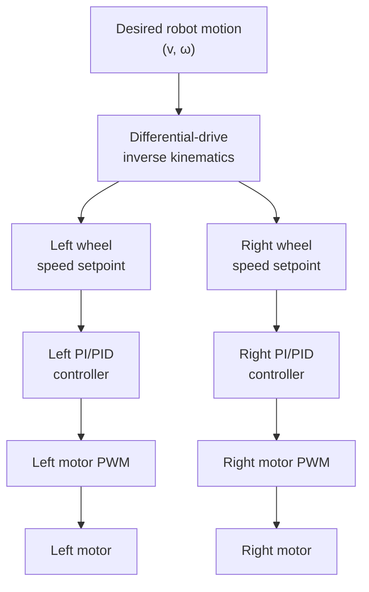

# Robotics & Embedded Systems Learning Notes

These notes document the concepts I learn while building the autonomous mapping robot.

## 1. DC Motors

### What is it?
A brushed DC motor converts electrical energy into rotational mechanical energy. Current flowing through coils in a magnetic field produces torque that rotates the shaft. Voltage influences speed, while current is related to torque.

### Why does our robot need it?
SEEKR uses two independently driven wheels for differential-drive movement. Geared DC motors reduce output RPM and increase available wheel torque, allowing controlled movement and sufficient driving force.

## 2. Motor Drivers & H-Bridges

### What is it?
A motor driver is an electronic circuit that uses low-power control signals to switch electrical power from a separate supply to a motor. An H-bridge is a four-switch arrangement that reverses the polarity across a DC motor to control its direction.

### Why does our robot need it?
The ESP32 GPIO pins cannot directly supply the voltage and current required by our geared DC motors. SEEKR needs two independently controlled H-bridge channels to drive its left and right wheels, allowing forward motion, reverse motion, and differential steering.

## 3. PWM Speed Control

### What is it?
Pulse Width Modulation (PWM) controls the average electrical drive by rapidly switching a signal between HIGH and LOW. Duty cycle is the percentage of each period spent HIGH, while frequency is the number of PWM cycles per second.

### Why does our robot need it?
SEEKR uses PWM from the ESP32 to command the motor driver and control the speed of each geared DC motor. Different PWM duty cycles allow the left and right wheels to run at different speeds for differential-drive movement and steering.

## 4. Wheel Encoders

### What is it?
A rotary encoder is a sensor that generates electrical signals as a motor shaft rotates. By counting these signals, the ESP32 can measure rotational displacement and calculate rotational speed. A quadrature encoder uses channels A and B, offset by 90 electrical degrees, so the direction of rotation can also be determined.

Important relationships:

- Wheel counts per revolution depend on the encoder resolution and the gearbox ratio.
- Wheel revolutions = encoder counts / counts per wheel revolution.
- Distance travelled = wheel revolutions × wheel circumference.
- Wheel RPM can be calculated from the number of wheel revolutions measured over a known time interval.

### Why does our robot need it?
SEEKR needs an encoder on each drive motor so the left and right wheel movement can be measured independently. Equal PWM commands do not guarantee equal wheel speeds, so encoder feedback allows the robot to detect and later correct these differences.

Encoders will support accurate straight-line driving, controlled turning, closed-loop speed control, and wheel odometry.

## 5. ESP32 Encoder Reading

### How does the ESP32 read an encoder?
Quadrature encoders generate digital HIGH/LOW signals on channels A and B. The ESP32 can detect these transitions using GPIO interrupts or its dedicated PCNT pulse-counting hardware. The phase relationship between channels A and B allows the ESP32 to determine rotation direction.

Different counting methods such as x1, x2, and x4 use different numbers of signal edges, which changes the effective encoder resolution.

The ESP32 can periodically read the accumulated encoder counts and use the change in counts over a known time interval to calculate wheel speed.

### Why does our robot need this?
SEEKR needs reliable and independent measurements of its left and right wheel motion. Since equal PWM commands do not guarantee equal wheel speeds, encoder measurements provide the feedback needed for accurate straight-line driving and controlled turning.

This also provides the foundation for closed-loop motor control, PID control, and wheel odometry.

## 6. Closed-Loop Motor Speed Control

### What is it?
Closed-loop motor control uses encoder feedback to adjust PWM so that a motor's measured speed follows its desired speed.

The ESP32 repeatedly performs:

Measured RPM → Calculate error → Adjust PWM → Repeat

The speed error is:

e = RPM_target - RPM_measured

A simple proportional controller can adjust PWM based on this error.

### Why does our robot need it?
SEEKR uses two independently driven DC motors. Closed-loop control allows the ESP32 to compensate for differences caused by load, friction, battery voltage, and motor characteristics.

Independent feedback loops for the left and right wheels improve straight-line driving, controlled turning, and movement repeatability.

Wheel slip and inaccurate wheel dimensions can still affect the robot's actual trajectory even if wheel-speed control is accurate.

## 7. PID Motor Speed Control

### What is PID control?
PID is a closed-loop control method that calculates motor corrections using three components:

- **P (Proportional):** responds to the current error.
- **I (Integral):** responds to accumulated error over time.
- **D (Derivative):** responds to how quickly the measured value is changing.

The wheel-speed error is:

$$
e(t) = \mathrm{RPM}_{\text{target}} - \mathrm{RPM}_{\text{measured}}
$$

A practical motor command can be written as:

$$
\mathrm{PWM} = \mathrm{PWM}_{\text{base}} + P + I + D
$$

where:

$$
P = K_p e(t)
$$

$$
I = K_i \int e(t)\,dt
$$

$$
D = -K_d \frac{d\,\mathrm{RPM}_{\text{measured}}}{dt}
$$

The ESP32 repeatedly:

1. Measures wheel speed using the encoder.
2. Calculates the speed error.
3. Calculates the P, I, and D terms.
4. Updates the PWM command.
5. Repeats the process at a regular control interval.

The PWM output must also be limited to the valid range supported by the motor-control system.

### Why does our robot need it?
SEEKR uses two independently driven DC motors. Even if both motors receive the same PWM command, they may not rotate at exactly the same speed because of differences in:

- motor characteristics
- friction
- mechanical load
- battery voltage
- wheel contact with the floor

SEEKR can use a separate PI/PID controller for each wheel so that each motor follows its requested wheel-speed setpoint more accurately.

This improves:

- straight-line driving
- repeatable turning
- wheel-speed consistency
- resistance to changing loads

For SEEKR, **PI control may be sufficient** if the derivative term does not provide a useful improvement, since derivative control can be sensitive to noisy encoder measurements.

### Important PID behavior

#### Proportional gain — Kp
Increasing \(K_p\) makes the controller respond more strongly to the current error.

Too little \(K_p\):
- slow response
- larger remaining error

Too much \(K_p\):
- overshoot
- oscillation
- possible instability

#### Integral gain — Ki
The integral term accumulates error over time and helps eliminate persistent steady-state error.

Too much \(K_i\) can cause:

- overshoot
- oscillation
- integral windup

Integral windup happens when the controller continues accumulating error even though the PWM output has already reached its maximum or minimum limit.

#### Derivative gain — Kd
The derivative term reacts to how quickly the measured wheel speed is changing.

It can help reduce:

- overshoot
- rapid oscillations

However, derivative control is sensitive to measurement noise, which is why some motor-speed controllers use only PI control.

### Controller flow

The basic control loop for each SEEKR wheel is:

```text
Target RPM
    ↓
Compare with measured RPM
    ↓
Calculate error
    ↓
PI/PID controller
    ↓
PWM command
    ↓
Motor driver
    ↓
DC motor
    ↓
Encoder
    ↓
Measured RPM
    └──────────── feedback
```

## 8. Differential-Drive Kinematics

### What is differential-drive kinematics?
Differential-drive kinematics describes how the motion of two independently driven wheels determines the robot's linear and angular motion.

By changing the relative speeds of the left and right wheels, SEEKR can drive straight, follow curved paths, or rotate in place.

### Why does SEEKR need it?
SEEKR's motion controller needs to convert a desired forward velocity and turning rate into individual left and right wheel-speed setpoints.

The ESP32 can use inverse differential-drive kinematics to calculate the required wheel speeds, convert those speeds into RPM, and send the resulting setpoints to the separate left and right PI/PID motor controllers.

### Important equations and concepts

Wheel linear speed is related to wheel angular speed by:

$$
v_{\text{wheel}} = r\omega_{\text{wheel}}
$$

The robot's forward linear velocity is:

$$
v = \frac{v_L + v_R}{2}
$$

The robot's angular velocity is:

$$
\omega = \frac{v_R - v_L}{L}
$$

where:

- $v_L$ = left wheel linear velocity
- $v_R$ = right wheel linear velocity
- $L$ = effective track width between the wheels
- $r$ = wheel radius

To convert desired robot motion into wheel-speed commands:

$$
v_L = v - \frac{\omega L}{2}
$$

$$
v_R = v + \frac{\omega L}{2}
$$

Wheel linear velocity can be converted to RPM using:

$$
\mathrm{RPM} =
\frac{60v_{\text{wheel}}}{2\pi r}
$$

For curved motion, the instantaneous turning radius is:

$$
R = \frac{v}{\omega}
$$

for $\omega \neq 0$.

### Movement rules

- Equal positive wheel speeds → straight forward motion.
- Equal negative wheel speeds → straight reverse motion.
- Unequal wheel speeds → curved motion.
- Right wheel faster than left → robot turns left.
- Left wheel faster than right → robot turns right.
- Equal and opposite wheel speeds → rotation in place.
- Larger track width produces a smaller angular velocity for the same difference in wheel speeds.

### Control flow




